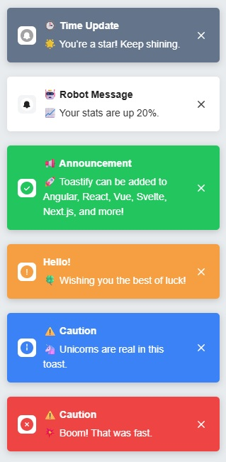

# Toastify – A Simple and Lightweight Toast Notification Library

Toastify is a super simple, fast, and easy-to-use toast notification library for modern web apps. It displays clean, customizable notifications with zero dependencies and supports ESM, CJS, and UMD builds for maximum compatibility.

---

<p align="center">
  
</p>

## Demo

You can try this library live:

👉 <a href="https://stackblitz.com/edit/vitejs-vite-md4bg7fw" target="_blank">Interactive Demo on StackBlitz</a>

🌐 <a href="https://andreasnicolaou.github.io/toastify/" target="_blank">UMD Build Test on GitHub Pages</a>

---


[](https://snyk.io/test/github/andreasnicolaou/toastify)


[](https://codecov.io/gh/andreasnicolaou/toastify)


## 

## Key Features

- **No Dependencies** – No external libraries required
- **Modern & Flexible** – ESM, CJS, and UMD builds for all environments
- **Fully Customizable** – Position, duration, icons, themes, stacking, and more
- **Theming** – Light/dark, custom classes, and icon support
- **Tiny & Fast** – Minimal footprint, instant rendering

## Installation

```sh
# npm
npm install @andreasnicolaou/toastify

# yarn
yarn add @andreasnicolaou/toastify

# pnpm
pnpm add @andreasnicolaou/toastify
```

### CDN / Direct Usage

```html
<!-- unpkg CDN (latest version, unminified) -->
<script src="https://unpkg.com/@andreasnicolaou/toastify/dist/index.umd.js"></script>

<!-- unpkg CDN (latest version, minified) -->
<script src="https://unpkg.com/@andreasnicolaou/toastify/dist/index.umd.min.js"></script>

<!-- jsDelivr CDN (un-minified) -->
<script src="https://cdn.jsdelivr.net/npm/@andreasnicolaou/toastify/dist/index.umd.js"></script>

<!-- jsDelivr/unpkg CDN (minified) -->
<script src="https://cdn.jsdelivr.net/npm/@andreasnicolaou/toastify/dist/index.umd.min.js"></script>

<!-- jsDelivr Styles (minified) -->
<link rel="stylesheet" href="https://unpkg.com/@andreasnicolaou/toastify/dist/styles.css" />
<link rel="stylesheet" href="https://cdn.jsdelivr.net/npm/@andreasnicolaou/toastify/dist/styles.css" />
```

**UMD (for `<script>` tags, global `toastify` variable):**

```html
<link rel="stylesheet" href="https://unpkg.com/@andreasnicolaou/toastify/dist/styles.css" />
<script src="https://unpkg.com/@andreasnicolaou/toastify/dist/index.umd.min.js"></script>
<script>
  const manager = new toastify.ToastifyManager('top-right', { closeButton: true });
  manager.success('Hello!', 'Toastify loaded from CDN!');
</script>
```

**ESM (modern bundlers):**

```js
import { ToastifyManager } from '@andreasnicolaou/toastify';
import '@andreasnicolaou/toastify/dist/styles.css';

const manager = new ToastifyManager('top-right', { closeButton: true });
manager.success('Success!', 'Toastify ESM import works!');
```

**CJS (Node/CommonJS):**

```js
const { ToastifyManager } = require('@andreasnicolaou/toastify');
require('@andreasnicolaou/toastify/dist/styles.css');

const manager = new ToastifyManager('top-right', { closeButton: true });
manager.info('Info', 'Toastify CJS import works!');
```

## Quick Usage Example

```js
import { ToastifyManager } from '@andreasnicolaou/toastify';
import '@andreasnicolaou/toastify/dist/styles.css';

const toast = new ToastifyManager('top-right', {
  closeButton: true,
  withProgressBar: true,
  newestOnTop: true,
});

toast.success('Success!', 'Your operation was completed successfully.');
toast.error('Error!', 'Something went wrong, please try again.');
toast.info('Heads Up!', 'You have new updates available.', { closeButton: false });
```

## Styling

- **Default:** Import or link the stylesheet for ready-to-use styles. The library **never injects a `<style>` tag at runtime**, so you must load it yourself:
  `import '@andreasnicolaou/toastify/styles.css'` (or `.../dist/styles.css`), a `<link>` tag, or the `styles` array in `angular.json`.
- **Spacing:** the gap between stacked toasts is the CSS variable `--noap-toastify-gap` (default `12px`) on `.noap-toastify-container`. Closing toasts collapse smoothly so the others slide into the gap.
- **Custom:** Pass a `customClasses` option to ToastifyManager to add your own classes and override styles as needed.

## API

### Toast Methods

| Function                            | Description               | Options (per toast, overrides manager)                                                                                                                                                 |
| ----------------------------------- | ------------------------- | -------------------------------------------------------------------------------------------------------------------------------------------------------------------------------------- |
| `default(title, message, options?)` | Displays a default toast. | `duration`, `isHtml`, `withProgressBar`, `progressBarDuration`, `closeButton`, `direction`, `showIcons`, `animationType`, `tapToDismiss`, `progressBarDirection`, `position`, `action` |
| `light(title, message, options?)`   | Displays a light toast.   | `duration`, `isHtml`, `withProgressBar`, `progressBarDuration`, `closeButton`, `direction`, `showIcons`, `animationType`, `tapToDismiss`, `progressBarDirection`, `position`, `action` |
| `error(title, message, options?)`   | Displays an error toast.  | `duration`, `isHtml`, `withProgressBar`, `progressBarDuration`, `closeButton`, `direction`, `showIcons`, `animationType`, `tapToDismiss`, `progressBarDirection`, `position`, `action` |
| `success(title, message, options?)` | Displays a success toast. | `duration`, `isHtml`, `withProgressBar`, `progressBarDuration`, `closeButton`, `direction`, `showIcons`, `animationType`, `tapToDismiss`, `progressBarDirection`, `position`, `action` |
| `warning(title, message, options?)` | Displays a warning toast. | `duration`, `isHtml`, `withProgressBar`, `progressBarDuration`, `closeButton`, `direction`, `showIcons`, `animationType`, `tapToDismiss`, `progressBarDirection`, `position`, `action` |
| `info(title, message, options?)`    | Displays an info toast.   | `duration`, `isHtml`, `withProgressBar`, `progressBarDuration`, `closeButton`, `direction`, `showIcons`, `animationType`, `tapToDismiss`, `progressBarDirection`, `position`, `action` |

All options can be set globally on the manager or per-toast (per call).

## Options

| Option                 | Description                                                                                           | Default Value |
| ---------------------- | ----------------------------------------------------------------------------------------------------- | ------------- |
| `duration`             | Time in milliseconds for the toast to remain visible. Setting this to 0 will stick the toast forever. | 3000          |
| `isHtml`               | Whether the message should support HTML.                                                              | false         |
| `withProgressBar`      | Show a progress bar for the toast.                                                                    | false         |
| `progressBarDuration`  | Duration of the progress bar (milliseconds).                                                          | 100           |
| `closeButton`          | Show a close button on the toast.                                                                     | false         |
| `showIcons`            | Show icons for each toast type (error, success, etc.).                                                | true          |
| `direction`            | Direction of the text (`ltr` or `rtl`).                                                               | ltr           |
| `customClasses`        | Custom CSS classes to add to the toast container.                                                     | ""            |
| `maxToasts`            | The maximum number of toasts that can be displayed at once.                                           | 5             |
| `animationType`        | Animation style: `fade`, `slide`, `zoom`, `bounce`, `flip`, `none`.                                   | fade          |
| `tapToDismiss`         | Dismiss toast on click/tap.                                                                           | false         |
| `newestOnTop`          | Stack newest toasts on top (`true`) or bottom (`false`).                                              | false         |
| `progressBarDirection` | Progress Bar direction either `increase` or `decrease`.                                               | decrease      |
| `position`             | Per-toast position (any `ToastifyPosition`). Falls back to the manager's position.                    | manager's     |
| `action`               | Button inside the toast: `{ label, onClick(handle), dismissOnClick? }`.                               | none          |

### Per-toast position

Pass `position` to show a single toast somewhere other than the manager's position. Containers are created lazily on first use and share the manager's `customClasses`. Each position keeps its own queue, so `maxToasts` and `newestOnTop` apply **per position**.

```ts
const toast = new ToastifyManager('top-right');

toast.info('Hello', 'Top right, as usual.');
toast.error('Offline', 'Connection lost.', { position: 'bottom-center', duration: 0 });
```

`position` is fixed once a toast is shown: `handle.update()` ignores it. Empty containers stay in the DOM (as with the manager's own container).

### Action button

`action` renders a `<button type="button" class="noap-toastify-action">` after the message. The label is always set as text (safe with `isHtml`). The toast is dismissed after the click unless `dismissOnClick: false`. Clicks on the button never trigger `tapToDismiss`.

```ts
toast.info('New version available', 'Reload to get the latest update.', {
  duration: 0,
  action: { label: 'Reload', onClick: () => location.reload() },
});

// keep the toast open and update it from the handler
toast.info('Upload', 'Failed.', {
  duration: 0,
  action: {
    label: 'Retry',
    dismissOnClick: false,
    onClick: (handle) => handle.update({ message: 'Retrying...', action: undefined }),
  },
});
```

Restyle it through `.noap-toastify-action` or its CSS variables: `--noap-toastify-action-bg`, `--noap-toastify-action-fg`, `--noap-toastify-action-hover-bg`, `--noap-toastify-action-hover-fg`.

### Cleaning up with `destroy()`

`destroy()` removes every container the manager created, drops queued toasts, and clears all timers and listeners of the visible ones. The manager can be reused afterwards (containers are created again on demand).

```ts
// Angular
private readonly toast = new ToastifyManager('top-right');
constructor() {
  inject(DestroyRef).onDestroy(() => this.toast.destroy());
}
```

> **Angular / zone.js:** progress bars use `setInterval`, which zone.js treats as a task that triggers change detection on every tick. Create the manager and show toasts inside `NgZone.runOutsideAngular()` if you use `withProgressBar`.

### Environment

Creating a `ToastifyManager` (or calling `destroy()`) never touches the DOM and works without a `document`. The first container is created when the first toast is shown; showing a toast without a `document` throws a `TypeError`. Guard calls on the server (for example with `isPlatformBrowser`).

### Theming & Customization

- Use the `customClasses` option to add your own classes for custom themes.
- Use the built-in `light` type for a light toast theme: `toast.light('Title', 'Message')`.

---

## Security

- The **title**, the **action label** and every message are inserted as text. Only `isHtml: true` (default `false`) renders the message as HTML, via `innerHTML`.
- **Never use `isHtml` with untrusted text** (user input, or API strings you do not fully control). The library ships no sanitizer: sanitize the string yourself first, or keep `isHtml` off and pass plain text.
- `isHtml` is the only code path that parses HTML. If your page enforces Trusted Types (`require-trusted-types-for 'script'`), leave `isHtml` off. Icons are built with `createElementNS`, so they work under Trusted Types.
- **CSP:** no `<style>` element is created and no `style` attribute is written. Progress and collapse values use CSS custom properties set through `style.setProperty()`, which a strict `style-src` allows. There is no `eval` or `new Function`.

## Accessibility

- Toasts get `role="status"` and `aria-live="polite"` for `info`, `success`, `default` and `light`, and `role="alert"` with `aria-live="assertive"` for `error` and `warning`. The role follows the type when you call `handle.update({ type })`.
- The close button is a `<button type="button" aria-label="Close">`. The label is English only for now.
- Animations and transitions are shortened to near-zero under `prefers-reduced-motion: reduce`.
- `tapToDismiss` is a pointer-only convenience. Use `closeButton` or an `action` for keyboard users.

---

## Updating Active Toasts

All toast methods (`success`, `error`, `info`, `warning`, `default`, `light`) return a **`ToastifyHandle`** that lets you update the toast in-place while it is still visible.

```ts
const handle = toast.info('Upload', 'Uploading...');

// Later — update message and type in-place
handle.update({ message: 'Processing on server...' });

// Final step — switch type, update message, start auto-dismiss with a progress bar
handle.update({
  title: 'Upload',
  message: 'Upload complete!',
  type: 'success',
  withProgressBar: true,
  progressBarDuration: 100,
});
```

Works seamlessly with real async code:

```ts
const handle = toast.info('GitHub', 'Fetching data...', { duration: 0 });
try {
  const resp = await fetch('https://api.github.com/repos/andreasnicolaou/toastify');
  handle.update({ message: 'Parsing response...' });
  const data = await resp.json();
  handle.update({
    title: 'Loaded',
    message: `⭐ ${data.stargazers_count} stars`,
    type: 'success',
    withProgressBar: true,
  });
} catch {
  handle.update({ title: 'Error', message: 'Request failed', type: 'error', duration: 5000 });
}
```

**Queued toasts work too.** If the toast is waiting behind `maxToasts`, calls to `handle.update()` are buffered and replayed the moment the toast appears — no polling, no race conditions.

### `ToastifyUpdateOptions`

| Property              | Type                          | Description                                              |
| --------------------- | ----------------------------- | -------------------------------------------------------- |
| `title`               | `string`                      | Replaces the toast title text                            |
| `message`             | `string`                      | Replaces the toast message text                          |
| `type`                | `ToastifyType`                | Swaps the visual type (colour + icon)                    |
| `duration`            | `number`                      | Restarts auto-dismiss timer (0 = indefinite)             |
| `withProgressBar`     | `boolean`                     | Adds or removes the progress bar                         |
| `progressBarDuration` | `number`                      | Interval (ms) per progress-bar tick                      |
| `closeButton`         | `boolean`                     | Shows or hides the close button                          |
| `isHtml`              | `boolean`                     | Interprets message as raw HTML                           |
| `tapToDismiss`        | `boolean`                     | Enables or disables tap-to-dismiss                       |
| `action`              | `ToastifyAction \| undefined` | Sets, changes or removes (`undefined`) the action button |

Any field from `ToastifyOptions` except `position` is accepted — only the keys you provide are changed, all others remain as-is.

> **Tip:** Use `duration: 0` on the initial call to prevent auto-dismiss while the operation is in progress, then supply a `duration` (or `withProgressBar: true`) on the final `update()` call to auto-dismiss once done.

---

## Contributing

Contributions are welcome! If you encounter issues or have ideas to enhance the library, feel free to submit an issue or pull request.
